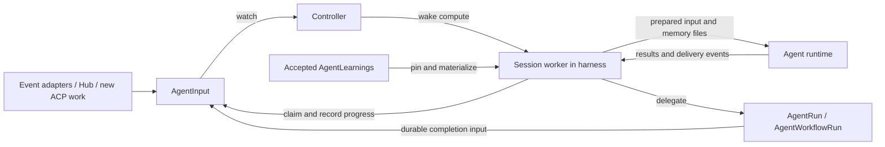

# ADR 0024: Durable Agent Sessions, Inputs, and Learnings

## Context

AgentRun and AgentWorkflowRun provide finite invocations. A review bot or
maintenance agent also needs a continuing identity that can accept events,
retain context, delegate work, and release compute while idle. A CVE event may
affect several applications and therefore need separate deliveries to several
sessions. One session should be able to delegate a fix and process another input
while that fix runs.

Continuity requires more than retaining a conversation. The system must know
which inputs it accepted, which decisions and actions completed, and which
knowledge was available to each invocation. The recovery principle is:
**preserve completed work, recover unfinished work where possible, and make
uncertainty visible.**

The memory research supports selective delivery of organized knowledge rather
than treating a whole transcript as standing instructions. DeepAgents provides
a relevant file-based model, while durable execution systems demonstrate that
execution progress and reusable memory are separate responsibilities. Those
mechanisms do not supply this project's approval or recovery contract by
themselves. See the [durability research][durability] and
[learning-delivery research][memory].

## Proposed decision

### 1. Add continuing sessions and addressed durable inputs

Introduce three proposed namespaced resources; exact schemas are deferred to
the spike:

- **AgentSession:** a continuing identity configured from an Agent, with its
  own conversation and mutable workspace. It can perform work directly or
  delegate AgentRuns and AgentWorkflowRuns.
- **AgentInput:** one durable request addressed to one AgentSession, with
  immutable request identity/payload and observable acceptance and completion.
- **AgentLearning:** a reviewable, reusable lesson with immutable content and
  applicability, separate from working notes and execution history.

An Agent remains a reusable template. AgentRun and AgentWorkflowRun retain
their finite-invocation meanings. Multiple sessions may serve the same
application without sharing a mutable workspace or becoming one conversation.

Event adapters and routers live above the generic controller. They interpret
events, classify destinations, and create addressed AgentInputs. Fan-out creates
one input per selected destination; durable routing identity and destination
records allow recovery after partial delivery. Labels aid discovery and
correlation; an explicit session reference determines input delivery.

The initial session model has one active input per session. Input ordering must
be explicit and reproducible; the spike will propose the admission/order key and
head-of-line behavior for interrupted work. A list/watch or worker queue
schedules reconciliation, but the AgentInput remains the durable work record.
Removing a queue item does not remove the input or prove completion.

Acceptance means the input identity and request are durably recorded, so a
producer retry can obtain the same receipt. Reusing an identity for a different
request is a conflict. Completion means the input's required state and outcome
are durable. Conditions report these guarantees; conditions alone do not
implement them. External transport acknowledgment can follow durable transfer
into this inbox without waiting for the agent to finish.

### 2. Keep orchestration outside the agent invocation

The Kubernetes controller remains stateless and domain-agnostic. It reconciles
CRs, wakes session compute through Agent Sandbox, and reflects lifecycle. It
does not interpret application inventory, connect to ACP, or run semantic
learning retrieval.

A **session worker** is a deterministic harness responsibility. The term does
not require a separate service or process. It claims inputs, restores state,
prepares learnings, drives the runtime, and persists progress. Claude, Goose,
Pi, or DeepAgents does not decide when to claim the next input or refresh its
approved knowledge. The intended integration target remains the shared
Lightspeed/DeepAgents runtime from [ADR 0021][runtime].



The worker reconciles an input as follows:

1. Acquire exclusive execution ownership and inspect durable progress. Return
   the existing outcome for already completed work.
2. For new work, resolve applicable accepted learnings, register their use, and
   commit the immutable selection before the first dependent agent invocation.
   Recovery reuses an existing selection and saved decisions.
3. Materialize and verify the memory files, prepare required context and the
   workspace, and configure the runtime.
4. Invoke or resume the runtime. Persist decisions and action results at the
   recovery boundaries the spike qualifies; do not replay the entire prompt
   when completed decisions can be reused.
5. Persist the required session checkpoint, outcome, and delegation references
   before marking the input complete. Release that input's learning use, then
   prepare the next input or become idle.

Preparation failures remain explicit and retryable where appropriate; they
must not silently omit selected knowledge. Ownership requires enforced fencing
or an equivalent commit-time guard. Lease expiry alone does not stop an old
worker or prevent external effects.

The first version sleeps between completed inputs. Sleep preserves the state
needed for the next input while releasing compute; it does not require freezing
a process or microVM. Agent Sandbox remains a hard dependency. Future Agent
Substrate/Agent Executor or other backends must be able to implement the same
contract, but their adoption and checkpoint compatibility require separate
qualification. No cluster-specific suspension feature is a prerequisite.

### 3. Separate dispatch completion from delegated work completion

A session can durably decide to create a child invocation, record its stable
identity, and complete the dispatch input while the child continues. Child
completion becomes another durable, deduplicated AgentInput. A recoverable
notification mechanism or reconciliation of outstanding children must prevent
a lost transient notification from losing the outcome.

If the worker crashes after creating a child, recovery finds that same child
rather than creating another. Retained intent/outcome records must also cover
the case where a completed child has already been garbage-collected. A child
owns its own lifetime and learning references after dispatch completes.

New user work received through ACP should enter the same input contract.
Permission replies, steering, and cancellation of active work remain control
interactions, not ordinary requests queued behind that work. UI/CLI connections
reach the workload through the existing access architecture; the controller is
not an ACP proxy. A future IDE can continue a session without requiring all
sessions to share one conversation.

### 4. Make side-effect recovery explicit

Persist action intent, a stable operation identity, and arguments before
dispatch; persist the result before relying on completion. Reuse a recorded
result. If an external action completed but its receipt was lost, reconcile
against the destination or retry under a supported idempotency contract.

When the result cannot be determined and repetition is unsafe, leave the input
visibly interrupted for intervention. A missing search result is not sufficient
proof that an external action never occurred. Compensation is action-specific
and may itself fail; there is no universal automatic undo or exactly-once
external-effect promise.

Use an internal action journal initially. This ADR does not propose an
AgentAction CRD; a separately managed action lifecycle would need its own
justification. Runtime/checkpoint facilities should be reused where they
satisfy the contract instead of duplicating model execution in the harness.

### 5. Share immutable, reviewed learnings through explicit snapshots

An AgentLearning contains a concise summary and relevance description, full
content, provenance/evidence references, and a generic applicability selector.
Content and applicability are immutable together. Changing either creates a
new proposal. Acceptance/rejection and later lifecycle state are separate from
that immutable content; rejected proposals remain history, not active guidance.

When policy requires human acceptance, the API or ACP interaction must record
the authenticated human's decision on the exact revision and scope. An agent
may propose a lesson or a replacement; it cannot assert that a human approved
it. Reflection and background consolidation produce proposals rather than
rewriting accepted shared knowledge.

Hub or another consumer supplies domain labels on workloads. A learning's
generic label selector can cover several applications, for example
`konveyor.io/application In ["42", "87"]`. Annotations can carry descriptive
provenance. Matching, acceptance, and authorization determine eligibility;
labels alone grant no authority. Start with namespace-scoped resolution;
cross-namespace sharing is not implied. Snapshot selection also freezes the
effect of workload labels for that consumer.

Selection happens at these boundaries:

- **Standalone AgentRun:** at invocation creation, before any queueing delay.
- **AgentWorkflowRun:** at invocation creation, once for the whole workflow.
  All stage AgentRuns inherit that set, including stages created much later.
- **AgentSession:** before starting each new AgentInput, even if compute is
  already awake. Retry or crash recovery retains the unfinished input's set.

Creation-time selection must be part of the durable invocation contract, not
an eventual lookup when a pod starts. Exact admission and transaction mechanics
are a spike outcome. A snapshot retains immutable identities and content
digests with the content or durable artifact references; a selector, mutable
name, or pointer to “latest” is insufficient.

An accepted explicit replacement automatically changes future selections.
Existing consumers retain their pinned revisions. **Revocation is refused
while any unfinished consumer references the learning.** Queued runs and whole
workflows between stages count, not only live pods. Consumers must finish or
actually stop/cancel and release their use first. This is not a disable-now,
drain-later policy. Deletion and artifact cleanup must respect those references
and history retention too.

New consumer admission and revocation must coordinate at an authoritative
boundary. A cached list or asynchronously maintained count cannot by itself
establish that revocation is safe. The spike must demonstrate the race behavior.

### 6. Materialize organized memory files and observe delivery

The harness prepares read-only files from the snapshot. The proposed layout is
illustrative, not an API or a claimed automatic DeepAgents convention:

```text
memory/index.md                       concise summaries and paths
memory/learnings/<revision-id>.md      metadata, lesson, detail, evidence
memory/manifest.json                   identities, digests, file mapping
```

Configure the index explicitly as startup memory. Short required statements
can be loaded directly; full procedures and evidence are read when relevant.
The manifest is bookkeeping, not prompt text. The runtime may choose what to
read within this fixed collection, but does not refresh its membership.
MCP is not required for this delivery path.

Review the summary, relevance description, and full content together. Generate
the index deterministically from approved text. Favor one reusable lesson per
record, a concise statement, and separate supporting detail. Show size during
review, establish context budgets, and use subordinate indexes as collections
grow. Do not silently truncate required guidance; the precise overflow and
conflict policy remains to be selected.

This extends the always-loaded rule/on-demand skill delivery pattern in
[ADR 0014][skills] without making AgentLearning a synonym for SkillCard. Keep
accepted memory separate from writable scratch state. Rehydrate required
guidance after restart or compaction and define its propagation to runtime
subagents. A newer selection must explicitly supersede older guidance that
may remain in historical conversation text.

The harness owns durable attribution records, using runtime events to observe:

- **Available:** a revision was materialized in the snapshot.
- **Advertised:** its summary entered the model's context.
- **Delivered:** its content or an identified excerpt entered a model call.
- **Agent-reported consideration:** an explicit applicability/conflict report,
  not proof of internal reasoning or compliance.

Events correlate the input, execution attempt, revision, and tool/model call.
File access alone cannot prove delivery after filtering or truncation; arbitrary
shell reads and runtime subagents require coverage assessment. Record delivered
results before subsequent reasoning relies on them. Preserve the runtime's
inspection boundaries for both model input and viewer output. Exact model-input
retention and mandatory acknowledgment are open questions, not implied by an
access log.

### 7. Preserve history independently of compute

Application history is a consumer-facing view over correlated inputs, sessions,
runs, workflows, outcomes, artifacts, and accepted/rejected learnings. Git
records code evolution; it is not the only history store. Hub can assemble the
view from generic labels and durable references without giving the controller
an application model or sharing every session's conversation/workspace.

Retain an AgentRun's transcript while that AgentRun exists, including after its
pod exits, and expose an authorized read path outside controller ACP handling.
Distinguish runtime conversation/checkpoint state, the user-visible inspected
transcript, and the action journal: none substitutes for the others. The spike
must establish what is durably captured, what remains incomplete after a crash,
and how references and retention survive pod or child-resource cleanup.

Storage must outlive worker compute. A PVC, object storage, and a metadata or
checkpoint store are candidates serving different needs; an S3-compatible
endpoint alone does not provide inbox claims or action atomicity. Deployment
topology, retention after resource deletion, backup, and the exact transcript
endpoint are deferred. Idle sessions must not require keeping credentials
alive indefinitely; renewal, revocation, and credential isolation need to be
qualified with the existing harness contract.

## Relationship to existing decisions

- [ADR 0001][architecture]: this proposal would replace only the deferred
  per-Agent MCP memory-service assumption for approved shared knowledge. It
  adds session primitives without changing generic controller boundaries or
  finite workflows' existing Git handoffs. It does not reverse the decision
  against a shared per-application workspace PVC for ordinary runs.
- [ADR 0007][harness]: adds deterministic session orchestration to the harness;
  existing finite invocations remain supported. Migration intelligence stays
  in skills/runtime, and push credentials stay with the harness.
- [ADR 0002][acp] and [ADR 0021][runtime]: preserve workload-facing ACP, runtime
  reuse, inspection, approvals, steering/cancellation, and execution controls.
  This proposes the durable-session follow-up; it does not silently change
  current preview interruption behavior or qualify another backend.
- [ADR 0020][outcomes]: input completion, session interruption, and delegated
  invocation outcomes must be mapped deliberately; this ADR chooses no new
  AgentRun outcome enum.

All of these changes are proposed. Earlier accepted decisions retain their
status until this proposal is accepted; their cross-references identify scope.

## Alternatives and consequences

- **Always-running session pods or mandatory VM snapshots:** unnecessary for
  sleeping between completed inputs and impose a stronger backend requirement.
  Persisted state permits later execution backends without promising portable
  process snapshots.
- **One global application conversation:** couples unrelated bots and mutable
  state. Separate sessions can share reviewed knowledge and correlated history.
- **Agent-driven polling and memory refresh:** makes delivery preparation
  depend on model behavior. Deterministic orchestration provides a reproducible
  boundary before the model runs.
- **All learning text in every prompt, or retrieval only:** the first grows
  without bound; the second can omit essential instructions. File-based hybrid
  delivery still needs workload evaluation to choose budgets and defaults.
- **Mutable shared memory with automatic promotion:** useful for working notes,
  but does not preserve approval scope or a consumer's original knowledge.
- **A hosted durable-agent engine as the contract:** existing engines may
  implement parts of this design, but their names do not establish the required
  Kubernetes admission, learning lifecycle, or external-effect guarantees.

The cost is a new durable orchestration responsibility, retained state, and
runtime integration. Refused revocation can require stopping long-lived work;
selection races and garbage collection need explicit design. The benefit is a
reviewable contract for continuing agents whose knowledge and completed work
survive replacement of their compute.

## Proposed next step

Review the responsibility boundaries and lifecycle guarantees, then execute
the [bounded spike][spike]. Its deliverables are a reproducible vertical slice,
failure evidence, proposed schemas/storage mechanics, and a go/no-go report.
The spike does not commit the project to a storage vendor, new execution
backend, or production API. IDE/CLI continuation, a general event-classifier
product, automatic learning extraction, and VM suspension are later work.

[architecture]: ./0001-agentic-platform-crd-architecture.md
[acp]: ./0002-acp-transport-and-observability.md
[harness]: ./0007-harness-thin-runner-and-skillcard-skills.md
[skills]: ./0014-skill-loading-and-prompt-assembly.md
[outcomes]: ./0020-run-outcome-model.md
[runtime]: ./0021-shared-runtime-and-conditional-lightspeed-execution.md
[durability]: ../research/2026-11-10-durable-session-guarantees.md
[memory]: ../research/2026-11-11-durable-agent-learning-delivery.md
[spike]: ../spikes/durable-agent-sessions-and-learnings.md
