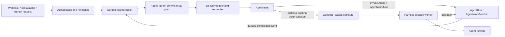

# ADR 0025: AgentSession — Durable Event Routing and Continuing Work

**Update (2026-11-12):** New PR commits should normally request another review,
with automatic review and treatment of older in-flight work configurable per
repository/task binding. Repository-file overrides and centrally configured
defaults are candidates; precedence and the trusted configuration revision
remain open. Duplicate input admission, repeated findings across revisions, and
recovery of uncertain comment publication are distinct problems.

**Update (2026-11-12):** Broaden the proposed AgentInput from a session-only
request to the common durable request for event-triggered execution. An input
selects an Agent or AgentWorkflow to invoke, or an existing AgentSession to
receive work. Finite invocation records the resulting AgentRun/AgentWorkflowRun;
it does not append unrelated work to an existing finite run. Start with a GitHub
PR-opened event producing a review AgentRun and a correlated review result.
This replaces the earlier diagram's direct event-to-run bypass of AgentInput;
"direct run" below means finite execution without a session. Public schemas and
eventing infrastructure remain exploratory and unimplemented.

**Update (2026-11-11):** Clarify that an AgentSession can itself be the routing
agent. Configured delivery may address a specialist directly or a session that
assesses the event and delegates onward. This does not require a separate
classifier resource or place model judgment in the event-delivery machinery.

**Update (2026-11-11):** Extend the initial ingress proposal to cover source
registration, ownership, validation, removal, and publication back to the source.
The first investigation uses a managed GitHub repository webhook; provider
bootstrap and live qualification remain explicit work, not implemented behavior.

This proposal separates continuing work from
[AgentLearning](0024-agent-learnings.md). Sessions can use existing skills and
an empty learning collection; shared learnings can ship for finite runs first.

[Review slides](../slides/agent-sessions-2026-11-11.pdf) ·
[Editable source and speaker notes](../slides/agent-sessions-2026-11-11.md) ·
[Ingress/session spike](../spikes/agent-session-event-routing.md)

## Use cases: when a session adds value

**A one-off webhook-triggered task does not by itself justify AgentSession.**
An authenticated event router can create an AgentRun or AgentWorkflowRun
directly. Shared approved knowledge is also available to those finite workloads.
The session proposal must earn its extra lifecycle through coordination across
multiple inputs, outstanding work, and subsequent human decisions.

- **PR review:** reviewing one head SHA can be a direct AgentRun. A session is
  useful when a bot must connect later revisions, reviewer feedback, and human
  instructions to its earlier decisions and outstanding review work. Preventing
  an obsolete review from being published also requires explicit source-version
  checks; conversation memory alone does not supply that behavior.
- **CVE remediation:** routing one advisory to many independent fixes can use
  finite workflows. A session adds ongoing ownership of an application's
  remediation: coordinating overlapping advisories, pending fix runs, exceptions,
  and later verification outcomes before deciding what to do next.
- **Jira-triggered work:** issue creation can launch a finite task. A session
  adds continuity when comments, approvals, child outcomes, and later events
  repeatedly change or advance that work while earlier delegations remain active.

The first spike compares both paths on the same event sequence. If a direct
run with explicit task state meets the need more simply, use it. Session value
must not be inferred from merely waking a pod or receiving a webhook.

## Proposed responsibilities

**AgentRouter** names an always-available event-ingress and delivery component,
not a selected public CRD. It authenticates sources, commits receipts, applies
versioned routes, persists destination plans, and reconciles delivery. A sleeping
session cannot host the only webhook endpoint that should wake it.

Propose a small separately deployed receiver/router alongside the existing
controller, using an ordinary Service and configured Ingress/OpenShift Route.
Source adapters normalize GitHub/Jira/CVE or caller events. A Hub adapter or
configured resolver supplies application inventory and destination mapping;
the core execution controller still does not call Hub or interpret applications.
The production placement and durable store need qualification, but these
responsibilities are part of this proposal, not an unspecified upstream box.

Route configuration names an authenticated source, supported event types,
deterministic predicates, work-identity policy, delivery purpose, and allowed
destinations. A destination can be a finite invocation or an existing session.
Rules identify the first recipient. That recipient can be a specialist session
or an AgentSession acting as a routing agent: it assesses the event and may
create an AgentRun/AgentWorkflowRun or address an AgentInput to another permitted
session. Both paths compose the same primitives; no separate classifier service
or resource is required. Record the routing decision and stable dispatch
identities before downstream delivery, using the normal action/admission
recovery contract. Initial delivery does not implicitly create arbitrary
sessions; provisioning is an explicit owner/policy action.

Here, AgentRouter remains a working name for the deterministic event-delivery
component. The agent that chooses subsequent work is an AgentSession. Public
configuration names and whether existing eventing resources supply delivery
remain open; the two responsibilities must not be conflated.

**AgentSession** is a continuing identity configured from an Agent, with its own
conversation, mutable workspace, and pending-work state. **AgentInput** is one
immutable addressed request with observable acceptance and completion. Its
execution choice is one of an Agent invocation, an AgentWorkflow invocation, or
delivery to an existing AgentSession. Multiple
sessions can serve the same application without sharing mutable workspaces.

Event configuration supplies matching rules, an allowed execution choice, and
the mapping from event data to invocation parameters. A webhook payload does not
grant permission to select arbitrary templates, credentials, or sessions. A
matched event becomes an AgentInput; finite dispatch creates and records its
AgentRun or AgentWorkflowRun using a stable identity. The input pins the resolved
invocation intent so retries cannot pick up changed route parameters. Exact
template snapshot rules remain to be specified. Acceptance, dispatch, and
execution outcome are independently visible. For finite work, creating the run
does not complete the requested work; session handling may complete an input
after recording a delegation while tracking that child's outcome separately.
Existing callers can continue creating AgentRuns and AgentWorkflowRuns directly;
this proposal does not require an input wrapper for every existing invocation.

The Kubernetes controller watches CRs and wakes compute through Agent Sandbox.
A deterministic **session worker in the harness** claims inputs, restores state,
prepares the invocation, and commits progress. The agent runtime reasons and
uses tools; it does not own webhook receipt, deduplication, or input claiming.
The intended runtime integration remains [ADR 0021](0021-shared-runtime-and-conditional-lightspeed-execution.md).



## Source setup and lifecycle

An input queue is only useful when source events can reach it. AgentRouter must
own source-subscription reconciliation as well as event delivery. Use an
internal subscription record initially; a public resource name/schema remains
open. A subscription binds provider/repository identity, desired events, stable
callback address, credential and signing-secret references, enabled state, and
ownership. Record provider hook ID, observed configuration generation, verified
delivery, and recovery coverage separately.

One source subscription can serve several routes and sessions. Adding a route
must not register another provider hook. The Hub or an operator supplies source
configuration and permitted destinations; the always-available integration layer
manages the subscription. Neither a sleeping session nor the execution controller
owns provider registration credentials.

Distinguish two explicit ownership modes:

- **Managed:** the router may create, update, disable, and remove its owned hook.
- **Existing:** bind a supplied provider hook ID and verify delivery; its owner
  retains lifecycle control. Do not silently adopt or delete it.

For the first spike, investigate one managed GitHub repository webhook. A
GitHub App's shared webhook is a separate mode: App registration, event selection,
installation, and App-level management credentials differ from repository-hook
management. Keep that alternative open without mixing the two control planes.
Jira registration also requires a chosen authentication/subscription model;
renewal and recovery must be qualified for that model. See the
[provider lifecycle research](../research/2026-11-11-agent-webhook-lifecycle.md).

### Reconcile registration before declaring the source ready

1. Persist desired subscription identity, a unique owned callback path, and the
   signing-secret version. Prepare a reachable receiver and durable inbox first.
   The callback path identifies ownership; it is not a secret or authorization.
2. Persist creation intent before the provider request. Investigate creating
   disabled, verifying a signed ping, then enabling events; test that sequence
   against the actual provider. A successful create response alone is not readiness.
3. Record the provider hook ID. A lost response becomes `CreateUnknown`.
   Discover only an exact owned callback and compatible saved intent; verify a
   single candidate before binding it. Ambiguous candidates or uncertain absence
   require intervention, not another blind create. Secret values are not
   recoverable from a masked provider response.
4. Record a verified delivery and activation boundary. Pings are health events,
   not AgentInputs. State what earlier source history is uncovered and whether
   current-state backfill can recover desired work.
5. Reconcile drift and delivery failures independently of session compute.
   Provider object existence, local pod health, and verified end-to-end delivery
   are separate observations. Detect duplicate owned hooks while keeping logical
   input deduplication independent of registration uniqueness.

Operator bootstrap supplies provider authority, allowed repositories, DNS/TLS,
durable storage, and Secret references. The spike must list these manual steps
and verify the automation that follows. It must not imply that creating an
AgentSession grants provider access or installs an App.

### Rotate and disconnect without losing responsibility

Keep API credentials, webhook-signing secrets, and runtime tool credentials
separate. Preserve configured signing secrets deliberately during provider
updates. For rotation, stage the new local verifier, update the provider, verify
newly signed delivery, then retire the old verifier after a bounded overlap.
Persist uncertain updates; keep credentials out of status/logs. Token expiry,
App key renewal, and revoked access require their own reconciliation.

Disabling a route stops new work for that route; disabling a shared source
affects all its routes. Define an explicit cutoff and handling of in-flight
deliveries. Drain accepted receipts/inputs or explicitly cancel them under their
normal lifecycle. For managed teardown, deactivate and delete only the owned
provider ID, verify uncertain deletion, and retain delivery/history records.
Lost credentials leave visible orphaned cleanup responsibility. Existing mode
never deletes the external owner's registration.

## Event-to-input contract

### 1. Authenticate and persist before acknowledging

The adapter validates provider authentication, configured tenant/source binding,
payload limits, and event type. Persist a receipt keyed by
`(tenant, source identity, provider event identity)` with the normalized event,
intent digest, normalizer version, and retained route-configuration revision.
Only acknowledge after that receipt and any required payload artifact are durable.
Persistence failure returns failure; a lost success response is safe to retry.
Webhook request handling does not wait for routing or agent completion.

Retries use the original identity and normalization contract. A conflicting
payload under the same immutable identity is visible and must never overwrite
accepted work. Store delivery-attempt metadata separately from canonical business
intent, so retry counters do not change the logical payload. Payload hashes
validate identity; they do not replace an event/work identity.

Provider behavior is part of each adapter's contract:

- GitHub preserves its delivery ID on redelivery, but **does not automatically
  redeliver failures**. A recovery job must inspect/request eligible deliveries
  using the configured webhook/app permissions and supported retention window.
- Jira Cloud provides a tenant-scoped identifier stable across retries, with
  bounded retries. Its failed-webhook API is not a universal recovery mechanism
  for every registration/authentication type.
- CloudEvents is a useful envelope, not a guarantee of retry-stable identity.

These facts and exact primary sources are recorded in the
[ingress research](../research/2026-11-11-agent-event-ingress.md). A provider outage
longer than its recovery window cannot be repaired by claiming at-least-once
delivery. Report gaps and, where supported, reconcile current source state;
that may restore desired work without reconstructing every historical event.

### 2. Commit a routing plan before fan-out

Resolve matching routes and permitted destinations asynchronously. Persist the
route revision, canonical intent, selected target namespace/name/UID, and delivery
purpose before creating any AgentInputs. Use an atomic commit or compare-and-swap
to choose one plan; losing planners reload the committed result.

For an event affecting twenty sessions, the destination set is part of the
record. If creation stops after eight inputs, recovery resumes the remaining
deliveries and recognizes the eight already created. Changes to inventory or
routing configuration do not silently select a different set on retry. A deleted
or unauthorized destination becomes a visible delivery failure, not a silent
redirect to a new session with the same name.

Route updates apply to new receipts. Re-evaluating an old event is an explicit
replay operation with provenance, not an incidental consequence of a restart.
Payloads/enrichment required for delivery must be retained with the plan; do not
refetch mutable source data and call the changed request a retry.

### 3. Distinguish transport duplicates from duplicate work

A retry-stable provider ID handles repeated delivery of one event. Different
events can still request the same work. Each route must decide whether to
coalesce them and define a semantic work key when appropriate:

- PR review: source/repository identity, PR identity, head SHA, and review
  purpose. An explicit re-review request adds its own request/replay identity.
- Jira issue creation: tenant, immutable issue identity, and creation purpose.
  Comments and updates need their own event/comment/change identity; using only
  the issue ID would suppress legitimate follow-up work.
- CVE remediation: feed/advisory identity and revision, target application or
  revision as required by the route's semantics, and remediation purpose.

These are route-policy examples to test, not universal deduplication keys. If a
source cannot supply a stable identity, require a caller key or document the
weaker guarantee. Do not claim that equal raw payloads always mean duplicate
work. Distinct receipts can refer to one logical delivery; retain their
provenance separately from the immutable AgentInput intent.

### 4. Make Kubernetes creation converge on one logical input

For illustration, use unambiguous, versioned canonical encoding:

```text
workKey = providerEventKey OR an explicit semantic work key
inputKey = encode(v1, tenant, source, routeIdentity, workKey,
                  targetKind, targetUID, purpose, replayEpoch)
inputName = "input-" + sha256(inputKey)[0:56]
```

Route identity is stable across configuration edits. A config update must not
accidentally create another input for a retry. An intentional replay has a new
explicit epoch/request ID. Include the target kind and UID (Agent, AgentWorkflow,
or AgentSession) so delayed work cannot target a replacement incarnation by name
alone. For finite work, persist the child run's stable creation identity before
creation and record its UID afterward; lost responses converge on that child,
not another invocation. Supported cleanup must preserve unfinished correlation
and the retained identity after completion.

Create the AgentInput using that exact `metadata.name`, not `generateName`.
Store the full identity and canonical intent digest. On `AlreadyExists`, read
and compare the complete identity, target UID, and intent digest. A match is
the existing input; a mismatch is an explicit conflict, never an overwrite.
After a timeout or lost create reply, perform the same lookup/create procedure.
The truncated hash is an index, not proof of identity.

A durable delivery row with a unique logical key exists **before** creation.
Use an admission gate so a newly materialized input cannot execute or be
normally garbage-collected before the router records its resource UID and
committed admission. Persist admission, then publish readiness; recovery repairs
a lost readiness update. This closes the gap where an input could finish and
be deleted before the router saved its create receipt. The exact CR condition,
finalizer, and authorization mechanism is a spike deliverable.

Keep the admitted-delivery record/tombstone after AgentInput cleanup. A late
retry must resolve to that record rather than recreate completed work. A missing
previously admitted input is reported/reconciled, not blindly recreated. Routine
cleanup must preserve this contract; force deletion of protected records is not
covered as successful recovery. Direct API/ACP producers must use the same
stable-identity admission contract to receive the same guarantee.

The promise is **one logical input per work identity and destination within a
declared retention horizon**. It is not exactly-once network delivery or exactly-once
external effects. Retain identities through supported provider retry/backfill
and operator replay windows, plus unfinished delivery/execution responsibility.
After dedup retention expires, define whether old events are rejected or can
be treated as new; indefinite suppression requires indefinite identity retention.

### 5. Keep ordering and supersession explicit

Deduplication does not establish event order. Record admission order separately
from provider occurrence/version information. For example, an older PR head can
arrive after a newer one. The review route must specify whether to retain,
supersede queued work, or skip stale work; record the disposition. Revalidate
source version before publishing a version-specific result when required.

A newer event is not a retry merely because it concerns the same issue, PR,
or CVE. Explicit replay, retry, and new desired work need distinguishable identities.

For the PR review example, enable review of new commits by default and make
that behavior configurable. A repository/task binding can choose how to handle
older work: queue newer work, cancel/supersede older work, or allow concurrent
work. Whether queued intermediate revisions are coalesced and whether older
results may publish are separate choices. Preserve a visible disposition for
every accepted input. These are policy dimensions, not settled public fields or
an accepted default for older reviews. Cancellation alone cannot prevent a
publisher already in flight; retain the revision attribution and publication
recovery contract below.

The proposed configuration boundary is the event-to-execution binding, which
can express different behavior for different repositories/tasks even when they
share a webhook endpoint. A repository file may supply permitted overrides or
review guidance. Exact precedence, filename, trusted source revision, and which
settings can be overridden remain open. Hub can project application choices
into this configuration; the controller does not acquire an application model.

Resolve dispatch-affecting settings in the provider/configuration adapter before
dispatch, rather than waiting for the agent to clone the repository. Record the
effective policy and source revisions with the immutable input intent; retries
reuse them, while later inputs may select new policy. The harness/review adapter
receives the same selected review configuration. Provider-specific configuration
lookup and comment semantics stay outside the generic execution controller.
This is a proposed mechanism; existing run parameters/file mounts are carriers,
not an implemented review-policy resolver.

The [CodeRabbit research](../research/2026-11-12-agent-review-policy-coderabbit.md)
provides examples of configurable automatic/incremental review, inherited policy,
administrative overrides, and history-aware review behavior. It does not provide
an exactly-once comment contract to inherit. Its documented use of feature-branch
configuration is a product choice to evaluate, not an assumed trust model here.

### 6. Make delivery responsibility observable

Expose the receipt identity, pinned route revision, each target's delivery key
and resource UID, retries, conflicts, and retention/recovery coverage. Receipt
acceptance, routing completion, input admission, input completion, and child
completion are distinct milestones. A stalled delivery must remain inspectable.

Scan durable pending records on router startup and periodically thereafter;
in-memory notifications are only scheduling hints. Transient failures retry
with bounded backoff, while permanent mapping/authorization conflicts remain
visible for intervention. Exhausting automatic retries must not erase an
accepted receipt or silently mark unfinished work complete.

## Session execution and recovery

The initial session model has one active input with enforced ownership/fencing.
A worker queue schedules reconciliation; AgentInput is the durable work record.
The worker inspects progress, prepares context, invokes/resumes the runtime, and
commits required state before input completion. A duplicate completion notification
returns the saved outcome instead of invoking the agent again.

If AgentLearning is enabled, the worker selects before each new input, even
while already awake, and restores the unfinished input's snapshot on retry.
Learning availability is not the justification for a persistent session.

A session may record a stable child invocation, complete the dispatch input,
and handle another input while the child runs. Child completion enters the same
durable admission path under a key derived from the child UID and terminal
outcome identity. Its saved result must survive notification loss and child
cleanup. Child work and its learning references have independent lifetimes.

Persist action intent and stable operation identity before dispatch, and results
before relying on completion. Reuse recorded results. If an external effect
succeeded without a saved receipt, reconcile with its destination or use a
supported idempotency contract. If uncertainty remains and repetition is unsafe,
leave a visible interruption for intervention. No universal undo or exactly-once
effect guarantee is proposed; begin with an internal action journal, not a new
AgentAction CRD.

Normal idle sleep occurs between completed inputs. Persist session context and
workspace recovery state, release compute, and use durable pending inputs to
close the arrival-versus-shutdown race. No process-memory or microVM snapshot
feature is required. Preserve Agent Sandbox as a hard dependency, existing
approval/ask-user/steering/cancellation and execution controls, inspection, and
harness-only push authority. Credential renewal and cleanup must be qualified.

New ACP work is an input; active permission replies, steering, and cancellation
remain control interactions. The controller is not an ACP intermediary. Retain
inspectable transcripts while the owning AgentRun exists, and keep user-visible
transcripts, runtime checkpoints, and action receipts distinct. Hub can correlate
application history without sharing every session's conversation/workspace.
Future IDE/CLI and Agent Substrate/Agent Executor integrations remain possible
but are separate qualifications, not prerequisites for this proposal.

## Close the loop with a correlated outcome

The demonstration must link subscription/hook identity, source delivery,
receipt, route plan, AgentInput UID, delegated AgentRun UID, durable child
outcome, completion input, and publication identity/provider result ID. A
successful webhook response proves receipt only; completing a dispatch input
is not proof of a successful child or a published result.

Use explicit API input with a stable caller key for initial human follow-up.
GitHub comment commands would additionally need an event subscription and
an author-authorization policy; a valid provider signature alone does not give
every commenter authority to steer work. Define how bot-authored publication
events are ignored or treated as acknowledgments, with recorded dispositions,
so publishing a result cannot start an unbounded feedback loop.

PR reviews need persistent publication history even when each revision uses an
independent AgentRun. Keep these three concerns separate:

- Repeated delivery of the same work resolves to the existing input/execution.
- A genuinely new review can rediscover an existing finding. The review adapter
  should correlate prior findings and provider threads, then apply an explicit
  policy for suppressing, updating, or replying to the existing discussion.
  Preserve human replies. Finding matching across moved/changed code needs its
  own qualification; hashing comment text is not proof of semantic identity.
- A comment may have been posted before its response was saved. Use the durable
  publication record and provider reconciliation below; a prompt instruction to
  avoid duplicate comments is not recovery machinery.

Retain this history beyond individual run/pod lifetimes under an explicit
retention policy. An AgentSession may use it, but is not required merely to
correlate comments across otherwise finite reviews.

A deterministic effect adapter records the session's desired publication with
repository/PR identity, reviewed SHA, and stable operation identity, then saves
the returned provider ID. For GitHub, always bind the review to the SHA actually
examined. Head lookup followed by review creation has a race; the first contract
is correct revision attribution plus explicit stale-result handling, not an
atomic promise that an old review can never appear after a new push. The
[review API](https://docs.github.com/en/rest/pulls/reviews) does not document such
a conditional creation primitive or caller idempotency key.

Fence concurrent publishers. Provider lookup and an operation marker can help
recover a lost publication response, but do not establish server-enforced
uniqueness. If the outcome cannot be determined safely, preserve a visible
interruption instead of blindly publishing twice. Test this return path and
provider recovery after restart, then demonstrate idle sleep and a later input
that uses the recorded outcome.

## Concrete first implementation to investigate

Build a small source-adapter/HTTP receiver and delivery reconciler as AgentRouter,
with route configuration and an internal receipt/plan/delivery store. These
records need not each become a public CRD. For a bounded experiment, use a
single active router with a retained SQLite store and transactional uniqueness
for receipts, plans, and delivery keys. Run it as a normal workload alongside
the controller. This is a prototype storage choice, not a production HA claim;
failover fencing, supported volume semantics, scale, and whether to reuse Hub
storage or a broker/database must be evaluated before adoption.

The store-to-Kubernetes boundary uses the admission protocol above rather than
claiming a transaction spans both. The router is useful for direct AgentRun
triggers too. Existing event infrastructure can supply adapters or transport,
but must still satisfy stable identity, recovery, retention, and delivery-state
requirements. No broker brand or CloudEvents envelope eliminates that work.

## Review and decision gate

The [spike](../spikes/agent-session-event-routing.md) starts with one real provider
contract, a duplicate-safe direct-run route, and then a session scenario that
requires later input to act on an outstanding delegation. It must demonstrate
both routing correctness and useful cross-input coordination before production
resource design is accepted. It includes ingress downtime and partial fan-out,
not only a manually created AgentInput followed by a pod wake-up.

This develops ADR 0021's durable-session follow-up and extends the harness role
in ADR 0007. It preserves generic controller boundaries and existing finite
invocation behavior. Exact schemas/conditions, router deployment ownership,
public route API, store/HA design, retention limits, interruption policy, and
runtime recovery capabilities remain open review outcomes.
